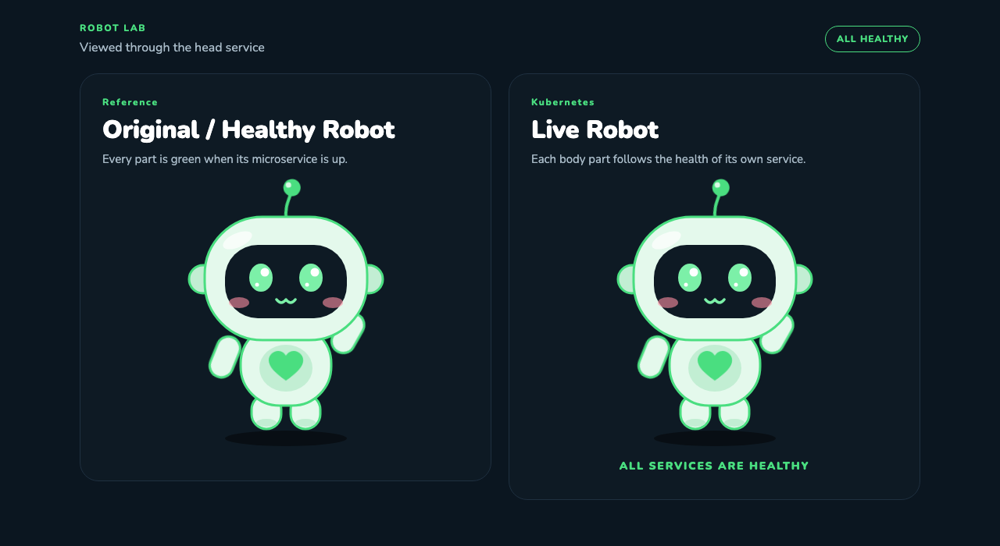
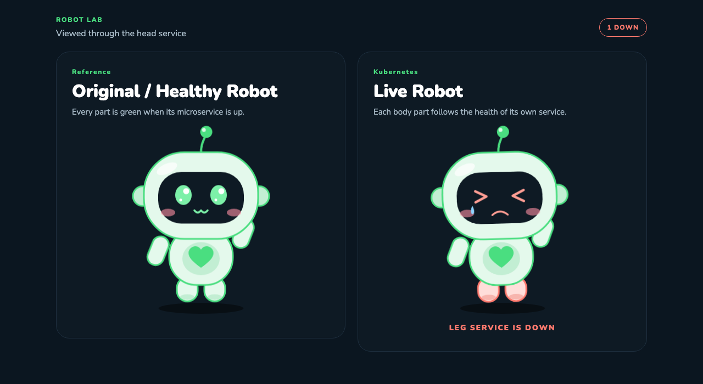

# Deploy on Kubernetes

Five Deployments, one namespace. Each Deployment is a body part. The head service shows a healthy reference robot next to a live robot. Delete a Deployment and only that part changes. Put the Deployment back and the part turns green again.

| Folder | Deployment | Service | Port | Body part |
| --- | --- | --- | --- | --- |
| `one/` | `legs` | `legs` | 3001 | Both legs |
| `two/` | `hands` | `hands` | 3002 | Both arms |
| `three/` | `stomach` | `stomach` | 3003 | Belly and heart |
| `four/` | `eyes` | `eyes` | 3004 | Face |
| `five/` | `head` | `head` | 3005 | Head, ears, and antenna |

Everything lands in the `robot` namespace. Images are `robot-legs:1.0.0`, `robot-hands:1.0.0`, `robot-stomach:1.0.0`, `robot-eyes:1.0.0`, and `robot-head:1.0.0`, with `imagePullPolicy: IfNotPresent`.

All five services up. The reference robot stays green, and the live robot matches it.



Legs Deployment removed. Both feet on the live robot switch to the down colors, and the line under it reads `LEG SERVICE IS DOWN`. The reference robot and the other four parts stay healthy.



## 1. Build the images

From `robot-microservices`:

```bash
./scripts/build-multiarch.sh
```

That loads the five images for the machine you are on. The Dockerfiles are `node:22-alpine` with no native addons, so the same build runs on Apple Silicon and on Intel or AMD Ubuntu.

For kind, load the local tags:

```bash
kind load docker-image \
  robot-legs:1.0.0 \
  robot-hands:1.0.0 \
  robot-stomach:1.0.0 \
  robot-eyes:1.0.0 \
  robot-head:1.0.0
```

## 2. Apply the manifests

```bash
kubectl apply -k .
kubectl -n robot get pods,svc
```

`kubectl apply -k .` creates the namespace and the five Deployments, Services, and Ingresses. It does not install Istio or Prometheus. Those manifests are under `platform/` and stay out of this apply on purpose.

One part can be applied on its own after the namespace exists:

```bash
kubectl apply -f platform/namespace.yaml
kubectl apply -k one
```

Wait until every pod is `Running`:

```bash
kubectl -n robot rollout status deployment/legs
kubectl -n robot rollout status deployment/hands
kubectl -n robot rollout status deployment/stomach
kubectl -n robot rollout status deployment/eyes
kubectl -n robot rollout status deployment/head
```

## 3. Open the robot

Port-forward the head service:

```bash
kubectl -n robot port-forward svc/head 3005:3005
```

Open http://127.0.0.1:3005.

Or use Ingress. The class in each `ingress.yaml` is `nginx`. Hosts:

- `head.robot.local`
- `legs.robot.local`
- `hands.robot.local`
- `stomach.robot.local`
- `eyes.robot.local`

Point those names at the ingress address. Every host serves the same comparison page.

## 4. Check that a part follows its Deployment

```bash
kubectl -n robot delete deployment legs
```

Within a couple of seconds both feet on the live robot switch to the down colors, and the line under it reads `LEG SERVICE IS DOWN`. The reference robot stays green. The other four parts stay in their healthy colors.

Put the legs back:

```bash
kubectl apply -k one
```

The feet return to green and the line changes to `ALL SERVICES ARE HEALTHY`.

Scale one part without touching the others:

```bash
kubectl -n robot scale deployment/hands --replicas=3
```

