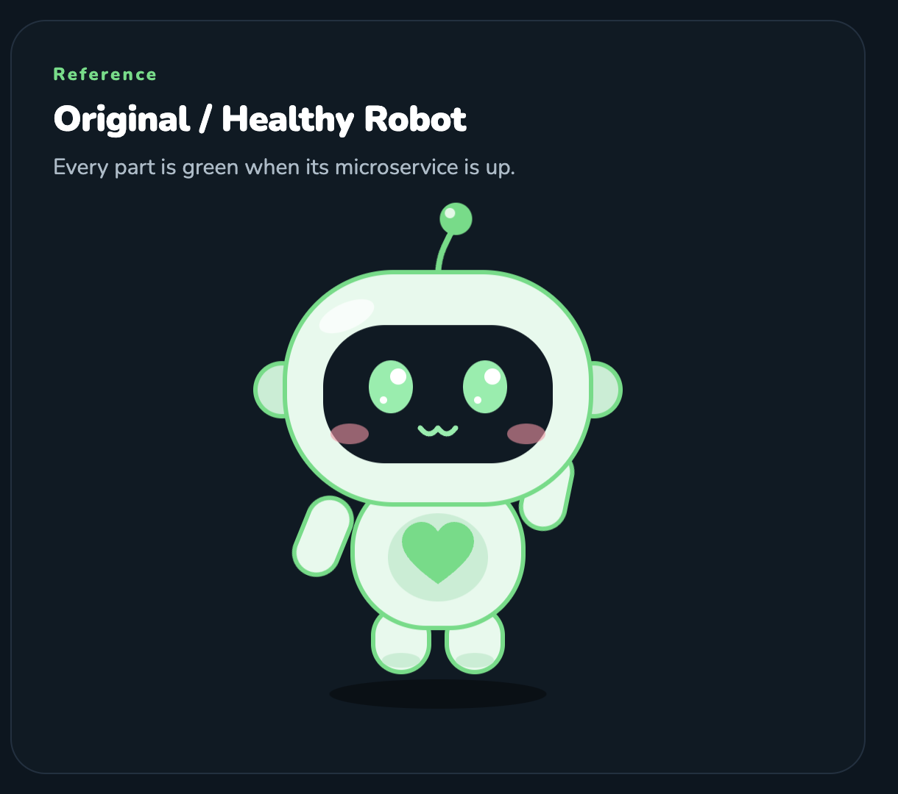
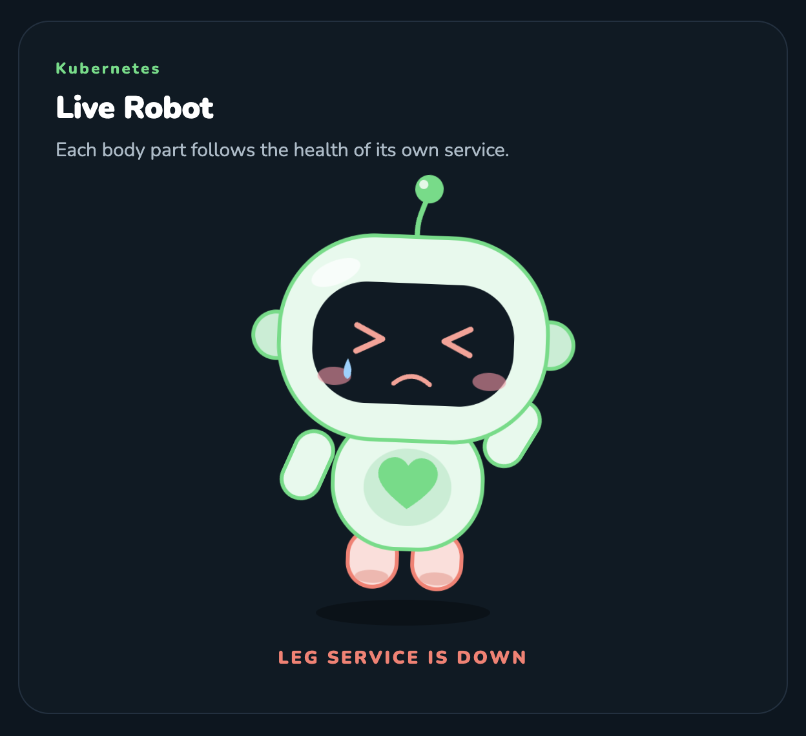

# Live Robot

This folder is the robot design. The page keeps this drawing and these animations, and colors each body part from its own microservice.

All five services up:



Legs service down. Both feet use the down colors, and the alert under the live robot says `LEG SERVICE IS DOWN`. The head, arms, and belly stay healthy.



## Files

- `Main.dc.html` — the artboard. Colors, type, spacing, and motion live in its inline styles and the `<helmet>` block.
- `support.js` and `vendor/react*.js` — the viewer that opens the artboard. They are not part of the drawing.

Serve this folder and open `Main.dc.html`. Some browsers block those scripts from a `file://` address.

```bash
python3 -m http.server
```
